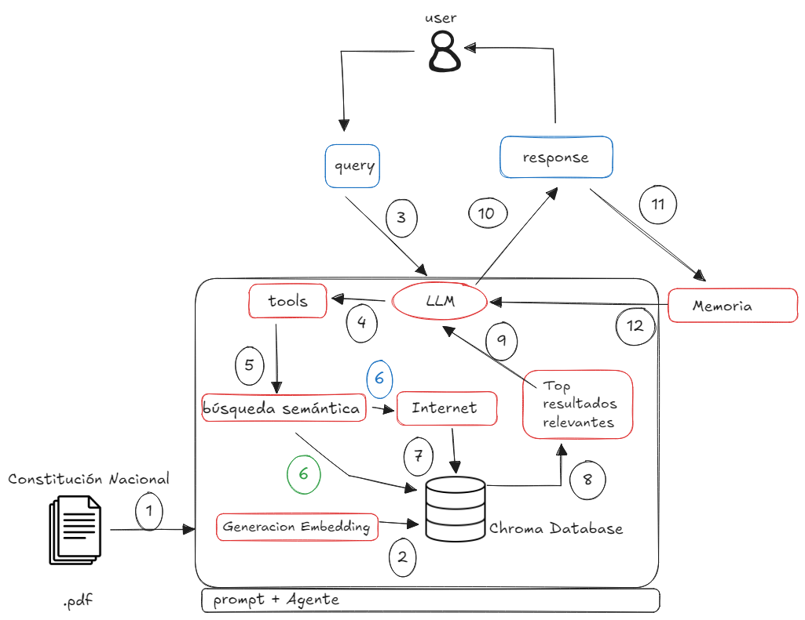

# AdrIA — Asistente sobre la Constitución Nacional Argentina

Chatbot con RAG que responde consultas sobre la Constitución Nacional Argentina, su historia y
temas legales relacionados. Construido con LangChain, OpenAI, Chroma y Streamlit.

**Demo:** [link de Streamlit]

> Si la demo muestra un aviso de suspensión por inactividad, tocá el botón para reactivarla
> (tarda alrededor de un minuto).

## Cómo funciona



1. **Indexación:** el texto de la Constitución (`docs/constitucionar.pdf`) se divide en fragmentos,
   se generan embeddings con OpenAI y se guardan en una base vectorial **Chroma** (`docs/Chroma/`).
2. **Consulta:** el usuario pregunta desde la interfaz de Streamlit.
3. **Agente:** un agente de LangChain con *tool calling* decide qué herramienta usar:
   - `busqueda_constitucion`: búsqueda semántica sobre la base Chroma.
   - `Wikipedia`: búsqueda en Wikipedia en español para contexto histórico. Cuando la usa, se lo
     informa al usuario.
4. **Respuesta:** el modelo responde con los fragmentos más relevantes como contexto.
5. **Memoria:** mantiene una ventana con los últimos mensajes para sostener la conversación.

El prompt limita al asistente a temas legales y constitucionales. Si la pregunta está fuera de ese
ámbito, responde con un mensaje fijo en lugar de improvisar.

## Stack

| Componente | Tecnología |
|---|---|
| Modelo | OpenAI `gpt-3.5-turbo` |
| Embeddings | OpenAI Embeddings |
| Base vectorial | Chroma |
| Orquestación | LangChain (agente con herramientas y memoria) |
| Interfaz | Streamlit |

## Estructura

```
app.py              Interfaz de chat en Streamlit
main.py             Agente: retriever, herramientas, prompt y memoria
embeddings.ipynb    Notebook que genera la base vectorial Chroma
docs/
  constitucionar.pdf   Fuente: Constitución Nacional Argentina
  Chroma/              Base vectorial persistida
  arquitectura.png     Diagrama del flujo
.streamlit/config.toml Tema visual
```

## Instalación local

```bash
python -m venv env
env\Scripts\activate          # Windows
# source env/bin/activate     # Linux / macOS
pip install -r requirements.txt
```

> En Windows, si PowerShell bloquea la activación del entorno, ejecutá
> `Set-ExecutionPolicy RemoteSigned -Scope CurrentUser` y volvé a activarlo.

Copiá `.env.example` como `.env` y completá tu clave:

```
OPENAI_API_KEY=...
```

La base Chroma ya viene incluida en `docs/Chroma/`. Para regenerarla, ejecutá todas las celdas de
`embeddings.ipynb`.

Ejecutar:

```bash
streamlit run app.py
```

## Ejemplos de consultas

- ¿Qué establece el artículo 14?
- ¿Cómo se relaciona el artículo 15 con la trata de personas?
- ¿Cuándo se reformó la Constitución por última vez y qué cambió?

## Próximas mejoras

- Citar el número de artículo de cada fragmento usado en la respuesta.
- Actualizar a un modelo más reciente.
- Incorporar otras leyes nacionales a la base de conocimiento.
